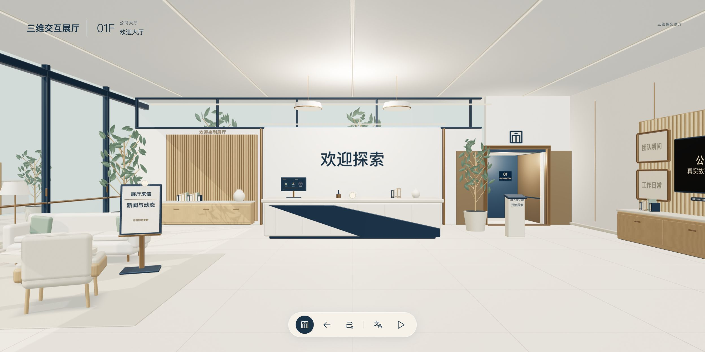
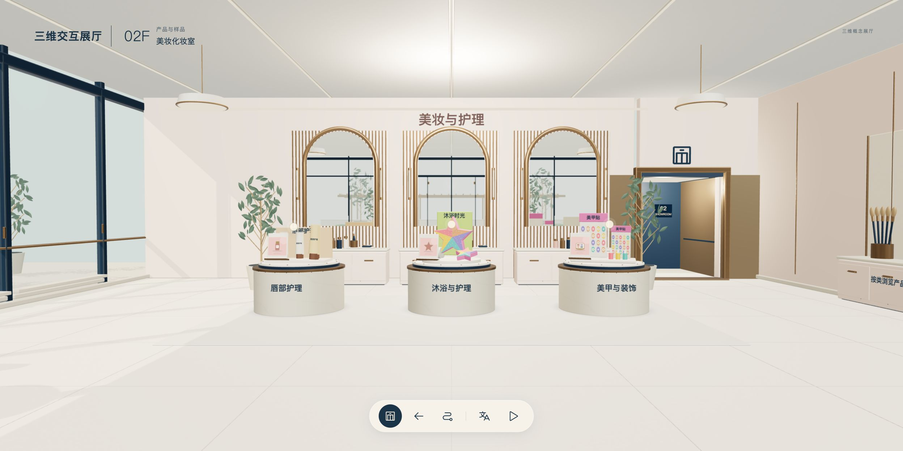
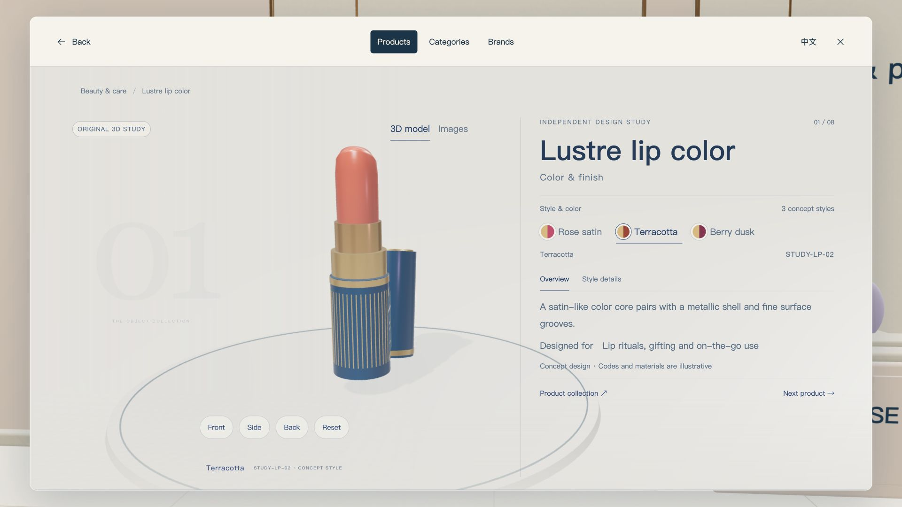

# Open Spatial Showroom

**可自行维护内容的通用三维交互展厅。** 用浏览器展示真实三维空间，支持自动导览、点击走近展品、产品分类检索、模型旋转、图片详情和中英文切换。适合企业展厅原型、产品展示、博物馆式内容探索和横向大屏演示。

A configurable, unbranded 3D showroom for browser-based exhibitions. Built with React and Three.js, with guided tours, interactive exhibits, reusable product exploration and bilingual content.

这是一套可运行的空间展示模板，包含源码和可重建模型。默认没有企业标志、真实品牌档案、客户名单或私有产品数据；产品插画、历程和合作展示均为示例。使用者可添加自己有权展示的内容。



## 可以做什么

- 九个示例空间：欢迎大厅、样品导览、美妆、儿童探索、生日派对、战略办公室，以及中国、美国、柬埔寨三个地区流程长廊。地区仅为可编辑的交互示例。
- 电梯连接楼层；地球选择地区，海外行程使用飞行动画。
- 自动巡游时收起主要界面；触摸、鼠标或键盘操作后接管，关闭内容后闲置恢复。
- 房间展位按分类打开产品列表，复用检索、详情和返回状态。随包提供 18 条示例产品、8 个程序化概念模型、14 个示例款式。
- 模型带有符合用途的动态部件，例如输送循环、加工装置、陈列转台、气球和星空。阅读内容时暂停背景绘制。
- 新闻、合作展示、照片墙、电视、外部产品网站入口可维护；新闻、照片和视频默认留空。
- 画质配置、自适应横屏界面、独立的绘制分辨率与界面尺寸。





## 快速开始

需要 **Node.js 22.12 或更高版本**、npm，以及支持 WebGL 2 的现代桌面浏览器。首次安装依赖需要联网。

```bash
git clone https://github.com/Hanyan179/open-spatial-showroom.git
cd open-spatial-showroom
npm ci
npm run dev
```

打开 [本地开发预览](http://localhost:5217/)。模型、示例图片和内嵌产品模块已随仓库提供，无需 Blender。不要直接双击 `index.html`，应用需要 HTTP 服务。

```bash
# 完整重建示例媒体、三维空间、内嵌产品模块及主应用
npm run build:all
npm test
npm run check:public

# 预览构建结果
npm run preview
```

打开 [构建预览](http://localhost:5218/)。默认只监听本机；需要局域网访问时执行 `npm run preview -- --host 0.0.0.0`，然后使用运行电脑的局域网地址及 `:5218` 端口。网络隔离与系统防火墙仍由部署者配置。

## 怎样操作

| 操作方式 | 行为 |
| --- | --- |
| 点击展品或光点 | 自动走近，再展开对应内容 |
| 拖动场景 / 可旋转样品 | 查看空间或转动样品 |
| 电梯按钮 | 选择楼层、房间及体验区 |
| 返回 / Escape | 沿原链路返回 |
| P / 空格 | 暂停或继续巡游 |
| 左右方向键 / PageUp、PageDown | 前后参观点，适合键盘和映射这些按键的翻页器 |
| Enter / M | 打开当前内容 / 电梯 |

输入框、弹窗和媒体操作优先处理自己的键盘事件。无触摸能力的大屏由连接电脑的鼠标、键盘或兼容翻页器控制；本项目不包含手机遥控服务。

## 维护入口

| 想改什么 | 从哪里开始 |
| --- | --- |
| 展厅名称、可选标志、外部网站与接口地址 | `public/showroom.config.json` |
| 公司介绍、历程、能力 | `public/data/company.json` |
| 房间产品、分类归属、图片 | `public/data/room-products.json` |
| 新闻与合作展示、日常照片视频 | `public/data/resources.json`、`company-life.json` |
| 模型、图片和视频产品探索 | `vendor/explorer/public/shared/` |
| 房间、光点、目录和参观顺序 | `src/spatial/scenes/`、`core/scene-registry.js` |
| 建筑、家具、展品结构与动态部件 | `src/spatial/scene-models/` |

详细步骤与字段示例见 [内容维护指南](docs/CONTENT.md)。交给编程助手时，从 [AGENTS.md](AGENTS.md) 和 [架构说明](docs/ARCHITECTURE.md) 开始。新增一个使用现有分类与展位的产品不需要建模；新增独立场景需要模型、场景定义与动线验证，不能靠任意增加一行配置完成。

## 部署与运行边界

`dist/` 可部署到常规静态网站服务，当前要求挂载在站点根路径。路由使用 `#/...`，GitHub 项目子路径部署尚未适配。GitHub 仓库地址用于分享源码，不是在线三维演示地址。

三维绘制发生在**连接屏幕的电脑及其显卡**；服务器传输程序和素材。提高服务器规格不会直接提高客户端帧率。可先选择较低画质，再根据屏幕分辨率和电脑能力调整。随包资源支持本地使用，但不是只允许离线：四个内容地址可改为后端接口，具体跨域、权限与身份认证由部署者实现。前端配置不可存放私密凭证。

本项目不包含后台编辑器、数据库、登录系统、远程视频渲染或头显支持。默认产品均为视觉概念；没有真实产品照片和视频。横向电脑与大屏是主要目标，手机版未适配。实际触摸屏及现场显卡仍需验收，浏览器模拟不能代替设备测试。

## 开发与贡献

- [架构与扩展](docs/ARCHITECTURE.md)
- [内容维护](docs/CONTENT.md)
- [开发助手规则](AGENTS.md)
- [贡献说明](CONTRIBUTING.md)
- [社区行为准则](CODE_OF_CONDUCT.md)
- [安全报告与部署边界](SECURITY.md)
- [当前维护与审核范围](docs/MAINTENANCE.md)
- [验证记录](docs/VALIDATION.md)
- [第三方素材与依赖](THIRD_PARTY_NOTICES.md)

欢迎通过问题反馈和合并请求改进。提交素材前确认拥有再分发权，避免提交客户数据、账号、私有端点或未经许可的品牌素材。

项目原创代码、程序化模型和示例插画以 [MIT 许可证](LICENSE) 发布；第三方资源保留各自许可证。
