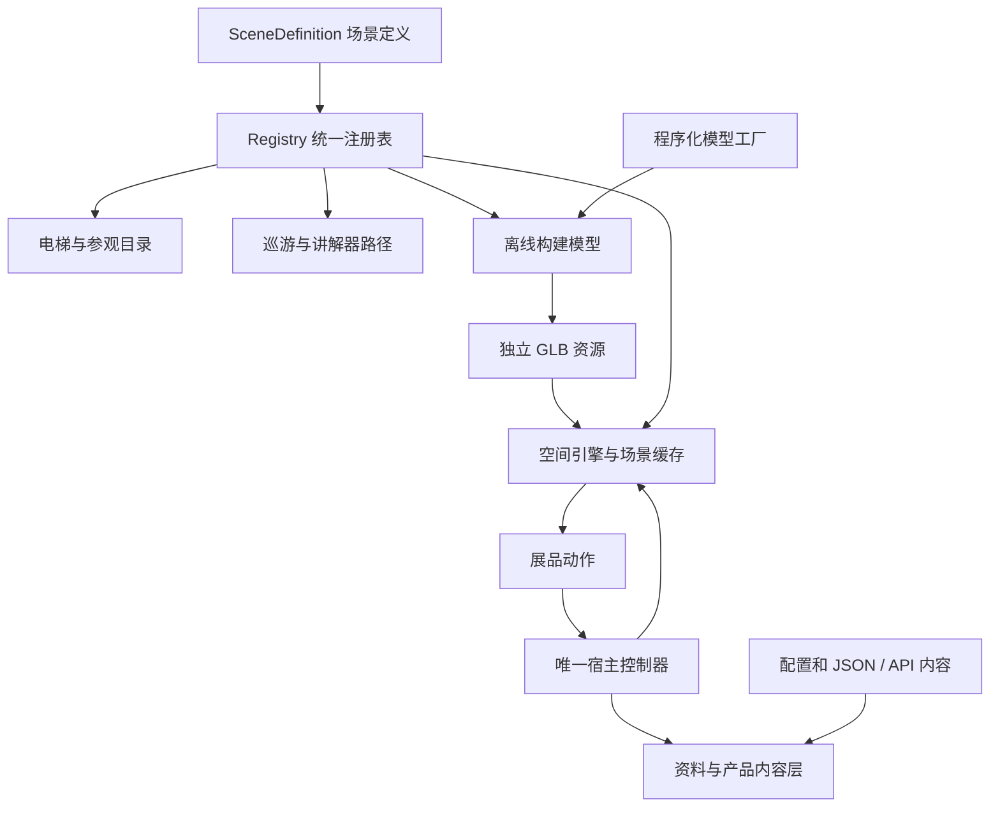

# 架构与扩展

核心实体是 `SceneDefinition`。它把房间身份、楼层、模型资源、视角、实体区域、光点动作和导览顺序放在同一份定义中。系统按此定义组织体验，楼层数字不决定内容归属。

## 模块责任

| 系统 | 入口 | 责任 |
| --- | --- | --- |
| 场景与动作 | `core/scene-registry.js`、`action-contracts.js` | 校验身份、引用、目录和动作 |
| 导览与状态 | `host/use-showroom-controller.js`、`use-guided-tour.js` | 一处管理接管、巡游、内容、返回与持久化 |
| 绘制和空间交互 | `engine/create-spatial-engine.js`、`paths.js` | 射线命中、拖动、相机路径、电梯与地区飞行 |
| 资源生命期 | `runtime.js` | 去重加载、当前/上一/下一场景缓存、释放 |
| 模型生成 | `build-scenes.js`、`scene-models/` | 生成结构、材料、标识挂点与动态部件 |
| 动作与环境微动 | `ambient.js`、`core/*motion.js` | 可暂停的纯时间函数、机械约束 |
| 内容适配 | `resource-client.js` 等 | URL、超时、数据读取与媒体归一化 |
| 系统界面 | `ui/`、`CompanyContent.jsx` 等 | 电梯、详情、响应式布局、公司与区域资料 |
| 产品探索器 | `ExplorerHost.jsx`、`vendor/explorer/` | 模型、图片、视频、款式与检索状态 |

产品探索器通过同源内嵌页面与宿主通信；语言、可见性、打开目标和交互通知走现有桥接协议。背景自动播放由宿主控制，避免两个系统争抢镜头。它是随项目维护的源码，名称中的 `vendor` 不代表从外部网站抓取的页面。

## 新增一个场景

1. 在 `src/spatial/scenes/` 添加定义，使用 `core/scene-definition.js` 的 `view`、`point`。选择稳定 `id`、现有或新楼层、`model` 和 `resource`。
2. 在 `scene-models/<model>.js` 实现默认导出的工厂。参考现有简单房间，返回同样的 `{root,...}` 结构。结构只在构建时生成，不导入主浏览器包。
3. 指定安全总览、每站相机、实际展品锚点、`areas`、`tour` 和内容动作。用已有动作可避免新增内容渲染器。
4. 在 `core/scene-registry.js` 导入并加入 `SCENE_DEFINITIONS`。这一次注册会进入目录、导览和导出流程。特殊建筑动线仍需扩展 `paths.js`。
5. 运行 `npm run build:scenes`、`npm run build` 和相应测试，实际操作电梯→展品→详情→返回，并检查移动中的碰撞与遮挡。

不完整场景可设置 `enabled:false`，不应把空房间加入自动巡游。新增动作时同步修改契约、路由、引用验证和 `ContentPanels.jsx`；现有检查会报告缺失的处理器。

## 可配置与需开发的边界

运行时可换：公司资料、产品列表、新闻、照片视频、配置的标志与外部产品网站。

需要重建：建筑、家具、展位几何、立体年份雕塑、合作展示的挂点数量、物理标识、内嵌产品模块内容。以 `company-gallery.js` 为例，年份与挂点身份在构建时来自本地 JSON；更换远程内容接口不会自动改变建筑几何，需保持 ID 对应并按需要重建。

需要代码设计：新房间、不同机械装置、自定义三维模型加载器、手机远程控制、后台编辑器和身份认证。配置替换不能代替这些功能。

## 渲染与设备

布局以 2496×1248 为初始参考，三维画面使用实际视口比例；界面按区域响应。`core/render-quality.js` 控制绘制像素、阴影和反射，界面文字不随画质一起降低。

只绘制当前场景；预加载下一场景，保留最近返回所需资源。内容打开时暂停背景绘制，关闭后恢复。用户空闲微动与自动换站是不同机制，暂停巡游并不等于所有物体停止工作。

浏览器在本机 GPU 绘制，静态服务器不逐帧渲染。模型资源增加影响下载与加载，高分辨率、阴影和反射主要影响客户端。性能记录必须注明视口、实际绘制分辨率、画质和硬件，不能将某台电脑的结果当作所有大屏保证。
